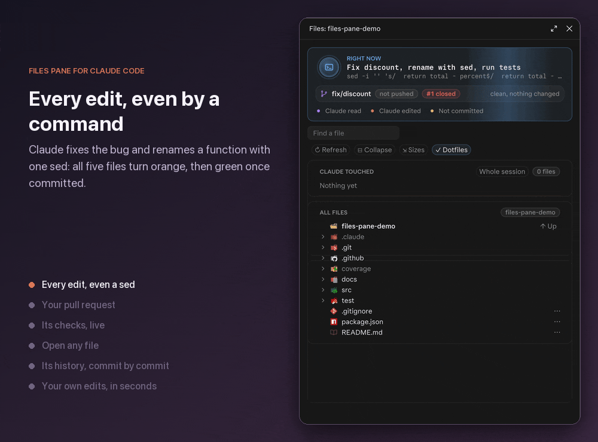

<a id="readme-top"></a>

<div align="center">

[![Claude Code mod][mod-shield]][mod-url]
[![Stars][stars-shield]][stars-url]
[![Issues][issues-shield]][issues-url]
[![MIT license][license-shield]][license-url]

</div>

<br />
<div align="center">
  

  <h3 align="center">Files pane for Claude Code</h3>

  <p align="center">
    See what Claude reads, edits and commits, live, in a VS Code-style file tree beside your chat.
    <br />
    <br />
    <a href="#about-the-project">View Demo</a>
    &middot;
    <a href="https://github.com/Marius-Adam/claude-files-pane/issues/new?template=bug_report.yml">Report Bug</a>
    &middot;
    <a href="https://github.com/Marius-Adam/claude-files-pane/issues/new?template=feature_request.yml">Request Feature</a>
    <br />
    <br />
    If you find this project helpful, please consider giving it a ⭐!
  </p>
</div>

<details>
  <summary>Table of Contents</summary>
  <ol>
    <li><a href="#about-the-project">About The Project</a></li>
    <li><a href="#getting-started">Getting Started</a></li>
    <li><a href="#usage">Usage</a></li>
    <li><a href="#troubleshooting">Troubleshooting</a></li>
    <li><a href="#contributing">Contributing</a></li>
    <li><a href="#license">License</a></li>
    <li><a href="#support">Support</a></li>
    <li><a href="#acknowledgments">Acknowledgments</a></li>
  </ol>
</details>

## About The Project



- **Live card**: Claude's thinking, the command it runs, the file it reads or edits
- **Tree that follows Claude**: opens to each file it edits, even in another project
- **Touched list**: files read or edited this turn or session, with lines added and removed, including files changed by a command Claude runs
- **Git**: branch, commits ahead and behind, its pull request with its checks and review, the worktree you're in, a rebase or merge in progress with its conflicts, changed files, ignored files dimmed
- **Search** with VS Code's icons, best matches first
- Works in the desktop app, VS Code and the terminal

### Built With

[![TypeScript][ts-shield]][ts-url] [![Claude Code][mod-shield]][mod-url] [![vscode-icons][icons-shield]][icons-url]

<p align="right">(<a href="#readme-top">back to top</a>)</p>

## Getting Started

### Prerequisites

[Claude Code](https://claude.com/claude-code) **2.1.299 or newer**: the desktop app, the VS Code extension or the CLI, on macOS, Linux or Windows. On an older one the mod does not load, and no pane appears (see [Troubleshooting](#troubleshooting)). On Windows, **Open in** offers VS Code, Cursor, Windsurf, Zed and Sublime Text when their command is on the PATH, and no JetBrains IDE.

### Installation

In the terminal:

```bash
claude plugin marketplace add Marius-Adam/claude-files-pane && claude plugin install files-pane@marius-adam
```

Or in a Claude Code session:

```
/plugin install files-pane --marketplace Marius-Adam/claude-files-pane
```

Restart Claude Code and the pane opens beside the chat.

To update or remove it later:

```bash
claude plugin marketplace update marius-adam && claude plugin update files-pane@marius-adam
```

```bash
claude plugin uninstall files-pane@marius-adam
```

<p align="right">(<a href="#readme-top">back to top</a>)</p>

## Usage

- `/files` brings the pane back if you close it.
- A click on a folder opens or closes it; a double click goes into it. The tree's first row names the folder you are in, and its **↑ Up** leads to the folder above.
- **N changed** shows only the files git reports changed, in their folders; press it again for the whole tree.
- Colours tell you what happened to a file: read **purple**, edited **orange**, uncommitted **yellow**, committed **green**.
- A press on a file opens it in a pane of its own, beside the Files pane, with three tabs: **File**, its text with its lines numbered (a Markdown file as its preview, a press from its source), **Diff**, what changed since the last commit, and **History**, the commits that changed it, each a press from what it changed. In VS Code, open it from its **⋯**.
- A file a command changes (a `sed`, a script, a formatter) counts as edited by Claude, as an Edit does, in a git repository. Not counted: files a command rewrites by moving HEAD, stashing, or starting or ending a merge or rebase, since git brought those in. Counted: a file a command puts back as it was committed (`git restore`), as Claude changed it. Counted by mistake: a file you save while one of Claude's commands is running, since the pane can't tell who wrote it.
- What changes without Claude, such as a file you make in your editor or a branch you check out in a terminal, shows within a few seconds while the pane is in sight.
- A file's **⋯** menu can open it, `@`-mention it, copy its path, show its diff, reveal it in the tree, or open it in your editor, Finder or Explorer.

**Privacy:** the pane is read-only. It lists folders, reads the files you open, reads git, asks GitHub's CLI for the branch's pull request and looks for your editors, sends nothing else anywhere, writes to your prompt only on **@ Mention**, and opens an app only on **Open in** or **Show in Finder** (**Show in Explorer** on Windows). [SECURITY.md](SECURITY.md#what-the-pane-runs) lists every command it runs, and says how to report a vulnerability.

**Tokens:** the pane costs none. Its hooks hand Claude's events on unchanged, and what it shows comes from your folders and git, so Claude never sees it. Only **@ Mention** adds to your prompt, the same as typing `@file`.

<p align="right">(<a href="#readme-top">back to top</a>)</p>

## Troubleshooting

**I closed the pane.** Type `/files` in a session to bring it back.

**No pane ever appears, and there is no `/files`.** The mod did not load. Check both:

```bash
claude --version
```

```bash
claude plugin list
```

Files pane needs Claude Code 2.1.299 or newer, and should be listed as `files-pane@marius-adam` with its status enabled. In the terminal, update with `claude update`; the desktop app and the VS Code extension update with the app and the extension. Then restart Claude Code.

**The tree has no git colours or branch.** Git is read only in the repository the session started in. A project the tree follows Claude into shows no git.

**The branch's pull request does not show.** It comes from [GitHub's CLI](https://cli.github.com), which must be on the PATH and signed in to an account that can see the repository: check with `gh auth status`. Without it the pane works the same, with no pull request. The pane asks again on **↻ Refresh**.

**Open in is missing, or lacks my editor.** On macOS the editor's app must be installed, and on Linux its command (`code`, `cursor`, `windsurf`, `zed`, `subl`) must be on the PATH. On Windows, see [Prerequisites](#prerequisites). The pane looks once a session, so restart Claude Code after installing one.

**Something else is wrong.** [Report a bug](https://github.com/Marius-Adam/claude-files-pane/issues/new?template=bug_report.yml) with the output of both commands above.

<p align="right">(<a href="#readme-top">back to top</a>)</p>

## Contributing

Contributions are welcome. Fork the repo and open a pull request, or open a [feature request](https://github.com/Marius-Adam/claude-files-pane/issues/new?template=feature_request.yml). If the pane is useful to you, a star helps others find it.

1. Fork the project
2. Create your feature branch (`git checkout -b feature/amazing-feature`)
3. Commit your changes (`git commit -m 'feat: add an amazing feature'`)
4. Push to the branch (`git push origin feature/amazing-feature`)
5. Open a pull request against the `staging` branch

### Develop

Run it from a clone, then check it before you push:

```bash
git clone https://github.com/Marius-Adam/claude-files-pane.git && cd claude-files-pane && claude --plugin-dir .
```

```bash
claude plugin validate . && claude plugin test .
```

Claude Code writes its API types into `.claude-plugin/types/` the first time it loads the mod; then `npx -p typescript tsc -p . --noEmit` type-checks it. CI runs validation and tests on every push.

Pull requests go to `staging`. A release is one pull request from `staging` to `main` that bumps the version in `.claude-plugin/plugin.json`, merged with a merge commit, since the marketplace installs from `main`.

| Path | What's there |
| :-- | :-- |
| `hooks/register.tsx` | The mod's hooks: what Claude does reaches the pane through these |
| `hooks/pane.tsx` | The pane's drawing: the card, git's line, search, the toolbar, the touched list and the tree |
| `hooks/file.tsx` | The file pane: a file opened from the tree, with its File, Diff and History tabs |
| `hooks/activity.ts` | Following Claude: the card's timing, commits, diffs, the files a command changes |
| `hooks/disk.ts` | Git, the branch's pull request, folder listings, the search index, a file's text, diff and history |
| `hooks/paths.ts` | Paths and sizes as the pane prints them, and search ranking |
| `hooks/look.ts` | Colours, type chips and SVGs |
| `hooks/icons.ts`, `icon-svgs.ts` | Which vscode-icons icon a file or folder gets, and the SVGs (generated) |
| `tests/` | Tests, against the terminal and desktop surfaces |

To add an icon, map a name, extension or folder in `hooks/icons.ts` to a [vscode-icons](https://icon-sets.iconify.design/vscode-icons/) id, then:

```bash
npm pack @iconify-json/vscode-icons && tar xzf iconify-json-vscode-icons-*.tgz && python3 scripts/gen_icons.py package/icons.json hooks/icons.ts hooks/icon-svgs.ts
```

### Top contributors

<a href="https://github.com/Marius-Adam/claude-files-pane/graphs/contributors">
  
</a>

<p align="right">(<a href="#readme-top">back to top</a>)</p>

## License

Distributed under the MIT License. See [LICENSE](LICENSE) for more information.

<p align="right">(<a href="#readme-top">back to top</a>)</p>

## Support

Files pane is free. If it saves you time, you can [buy me a coffee on Ko-fi](https://ko-fi.com/adamms).

Project link: [github.com/Marius-Adam/claude-files-pane](https://github.com/Marius-Adam/claude-files-pane)

<p align="right">(<a href="#readme-top">back to top</a>)</p>

## Acknowledgments

- [vscode-icons](https://github.com/vscode-icons/vscode-icons) (MIT) for the file and folder icons
- [Best-README-Template](https://github.com/othneildrew/Best-README-Template) for this README's layout

<p align="right">(<a href="#readme-top">back to top</a>)</p>

[mod-shield]: https://img.shields.io/badge/Claude%20Code-mod-D97757?style=for-the-badge&logo=claude&logoColor=fff
[mod-url]: https://claude.com/claude-code
[stars-shield]: https://img.shields.io/github/stars/Marius-Adam/claude-files-pane?style=for-the-badge&color=555
[stars-url]: https://github.com/Marius-Adam/claude-files-pane/stargazers
[issues-shield]: https://img.shields.io/github/issues/Marius-Adam/claude-files-pane?style=for-the-badge&color=555
[issues-url]: https://github.com/Marius-Adam/claude-files-pane/issues
[license-shield]: https://img.shields.io/badge/license-MIT-555?style=for-the-badge
[license-url]: LICENSE
[ts-shield]: https://img.shields.io/badge/TypeScript-3178C6?style=for-the-badge&logo=typescript&logoColor=white
[ts-url]: https://www.typescriptlang.org/
[icons-shield]: https://img.shields.io/badge/vscode--icons-007ACC?style=for-the-badge&logo=visualstudiocode&logoColor=white
[icons-url]: https://github.com/vscode-icons/vscode-icons
