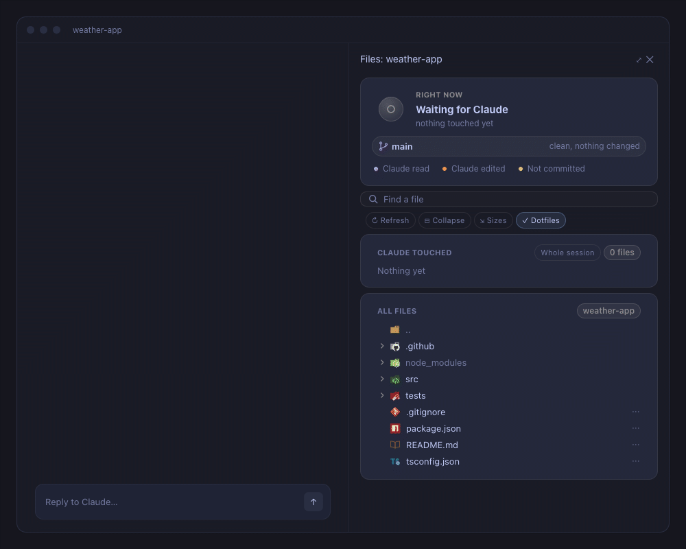

<a id="readme-top"></a>

<p align="center">
  
</p>

<h1 align="center">Files pane for Claude Code</h1>

<p align="center">
  A file explorer for Claude Code: see what Claude reads, edits and commits, live, in a VS Code-style file tree beside your chat.
</p>

<p align="center">
  
  <a href="https://github.com/Marius-Adam/claude-files-pane/stargazers"></a>
  <a href="LICENSE"></a>
</p>

<p align="center">
  
</p>

## Install

In the terminal:

```bash
claude plugin marketplace add Marius-Adam/claude-files-pane && claude plugin install files-pane@marius-adam
```

Or in a Claude Code session:

```
/plugin install files-pane --marketplace Marius-Adam/claude-files-pane
```

Restart Claude Code and the pane opens beside the chat. `/files` brings it back if you close it.

## Features

- **Live card**: Claude's thinking, the command it runs, the file it reads or edits
- **Tree that follows Claude**: opens to each file it edits, even in another project
- **Touched list**: files read or edited this turn or session, with lines added and removed
- **Colours**: read purple, edited orange, uncommitted yellow, committed green
- **⋯ menu**: `@`-mention, copy path, inline diff, reveal in tree, open in your editor or Finder
- **Git**: branch, commits ahead, changed files, ignored files dimmed; optional
- **Search** with VS Code's icons, best matches first
- Desktop app, VS Code and terminal (text for icons)

**Privacy:** read-only. It lists folders, runs read-only git (`status`, `diff`, `rev-parse`, `ls-files`, `rev-list`, `show`) and checks which editors are installed. It sends nothing anywhere, writes to your prompt only on **@ Mention**, and opens an app only on **Open in** or **Show in Finder**.

## Update or remove

```bash
claude plugin marketplace update marius-adam && claude plugin update files-pane@marius-adam
```

```bash
claude plugin uninstall files-pane@marius-adam
```

## Contributing

Contributions are welcome. If you have an idea that would make the pane better, fork the repo and open a pull request, or open an issue with the label "enhancement". And if it is useful to you, a star helps others find it.

1. Fork the project
2. Create your feature branch (`git checkout -b feature/amazing-feature`)
3. Commit your changes (`git commit -m 'feat: add an amazing feature'`)
4. Push to the branch (`git push origin feature/amazing-feature`)
5. Open a pull request

<details>
<summary><b>Develop</b></summary>

<br>

Run it from a clone, then check it before you push:

```bash
git clone https://github.com/Marius-Adam/claude-files-pane.git && cd claude-files-pane && claude --plugin-dir .
```

```bash
claude plugin validate . && claude plugin test .
```

Claude Code writes its API types into `.claude-plugin/types/` the first time it loads the mod; then `npx -p typescript tsc -p . --noEmit` type-checks it. CI runs validation and tests on every push.

| Path | What's there |
| :-- | :-- |
| `hooks/register.tsx` | The mod's hooks: what Claude does reaches the pane through these |
| `hooks/pane.tsx` | The pane's drawing: the card, git's line, search, the toolbar, the touched list and the tree |
| `hooks/activity.ts` | Following Claude: the card's timing, commits, diffs |
| `hooks/disk.ts` | Git, folder listings, the search index, a file's diff |
| `hooks/paths.ts` | Paths and sizes as the pane prints them, and search ranking |
| `hooks/look.ts` | Colours, type chips and SVGs |
| `hooks/icons.ts`, `icon-svgs.ts` | Which vscode-icons icon a file or folder gets, and the SVGs (generated) |
| `scripts/demo/` | Turns a screen recording of the pane into `docs/demo.gif` |
| `tests/` | Tests, against the terminal and desktop surfaces |

To add an icon, map a name, extension or folder in `hooks/icons.ts` to a [vscode-icons](https://icon-sets.iconify.design/vscode-icons/) id, then:

```bash
npm pack @iconify-json/vscode-icons && tar xzf iconify-json-vscode-icons-*.tgz && python3 scripts/gen_icons.py package/icons.json hooks/icons.ts hooks/icon-svgs.ts
```

The demo GIF is a recording of the desktop app (needs macOS, ffmpeg, gifski and Python 3 with Pillow). Record the window while Claude works, `touch stop` to end it, set the parts to show in `scripts/demo/cuts.json`, then make the GIF:

```bash
python3 scripts/demo/record.py take.mov stop <x,y,w,h> && scripts/demo/make.sh take.mov
```

</details>

### Top contributors:

<a href="https://github.com/Marius-Adam/claude-files-pane/graphs/contributors">
  
</a>

<p align="right">(<a href="#readme-top">back to top</a>)</p>

## License

[MIT](LICENSE). Icons from [vscode-icons](https://github.com/vscode-icons/vscode-icons) (MIT).